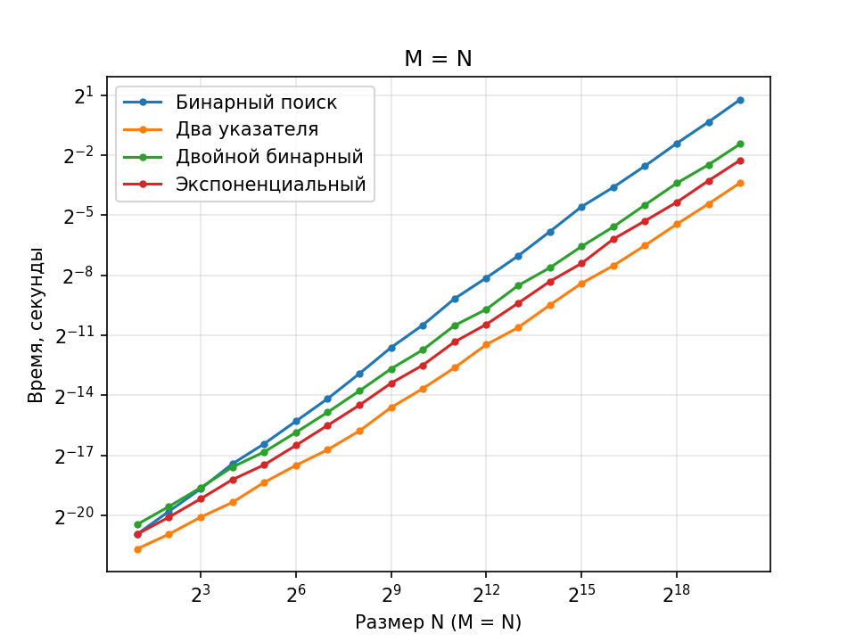
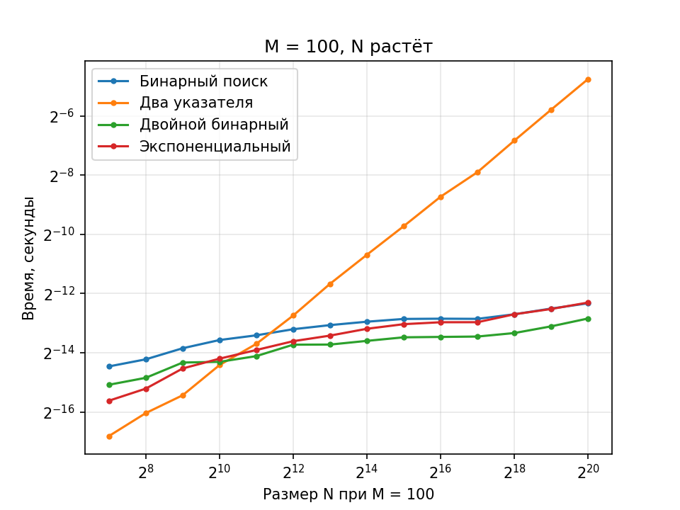
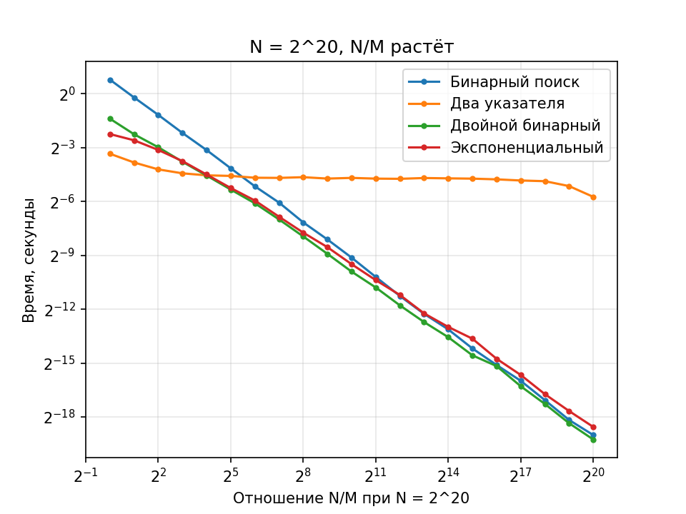

# Описание лабораторной работы

## Задачи проекта

Даны два отсортированных массива целых чисел длины `M` и `N` (`M ≤ N`). Необходимо определить, есть ли в них хотя бы один общий элемент.

**Цель:** реализовать четыре разных решения задачи. Выяснить при каком размере массивов какой алгоритм эффективнее.

## Архитектура проекта
* `algorithms/` — реализация 4 алгоритмов
* `tests/tests.py` — тесты на корректность
* `make_data.py` — замеры времени, результат пишется в `data/results.csv`
* `plot.py` — графики из CSV (логарифмические оси)
* `main.py` — запускает генерацию данных (`make_data.py`), сохраняет их в `results.csv` и вызывает построение графиков (`plot.py`)
* `data/` — сырые замеры (`results.csv`)
* `plots/` — графики после запуска `plot.py` / `main.py`

### Как устроены данные и замеры:

* Массив `a` длины `N` состоит из чётных чисел `0, 2, 4, …`.
* Массив `b` длины `M` состоит из нечётных чисел, равномерно распределённых по диапазону `a`, поэтому общих элементов нет.
* Для каждой пары размеров использовалось **минимальное** время (таймер `time.perf_counter()`) из **5** запусков для устранения влияния фоновых процессов.
* Таблица `results.csv` содержит колонки `experiment`, `algorithm`, `m`, `n`, `ratio` (= `n / m`), `time` (в секундах).

## Выводы по лабораторной работе

Сценарии:

1. `identical_size`: `M = N`, размер от 2 до 2²⁰;
2. `fixed_m`: `M = 100`, `N` от 128 до 2²⁰;
3. `varying_ratio`: `N = 2²⁰` фиксировано, `M = N / 2^k`, то есть отношение `N / M` растёт от 1 до 2²⁰.
## Анализ тестов и графики
 
#### 1) Массивы одинакового размера (`M = N`)
 

 
Быстрее всех работают два указателя, за ними идут экспоненциальный и двойной бинарный поиск, медленнее всех обычный бинарный поиск. При `N = 2^20` два указателя занимают 0.096 с, а бинарный поиск 1.711 с, то есть он медленнее почти в 18 раз. Так получается, потому что бинарный поиск делает `N` поисков (по одному на каждый элемент), и каждый поиск стоит около `log N` шагов, то есть всего `O(N log N)`, а у двух указателей один линейный проход `O(N)`.
 
#### 2) Один массив мал (`M = 100`, `N` растёт)
 

 
Время двух указателей растёт вместе с `N`, потому что им нужно пройти большой массив почти целиком. У остальных алгоритмов время почти не меняется: они делают только 100 поисков, а `N` входит под логарифм. Два указателя перестают быть лучшими при `N` около 2^11, а при `N = 2^20` они медленнее двойного бинарного поиска примерно в 270 раз (0.037 с против 0.000136 с).
 
#### 3) Отношение `N / M` растёт (`N = 2^20`, `M` уменьшается)
 

 
Время двух указателей почти не меняется (около 0.04 с), потому что `N` постоянно, а у алгоритмов с поиском время падает вместе с `M`. При `N / M` до 8 быстрее два указателя, при `N / M` около 16 двойной бинарный поиск их догоняет, а начиная с 32 двойной бинарный и экспоненциальный поиск быстрее.
 
## Общие выводы
 
1. При малом отношении `N / M` (до 8) лучше использовать **два указателя**.
2. При большом отношении (от 32) лучше **двойной бинарный** или **экспоненциальный** поиск, точка перелома находится около 16.
3. Обычный бинарный поиск почти нигде не лучший: при `M = N` он самый медленный, а при большом отношении равен остальным поискам или чуть хуже.
